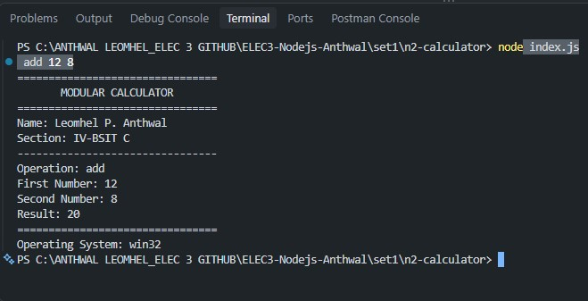
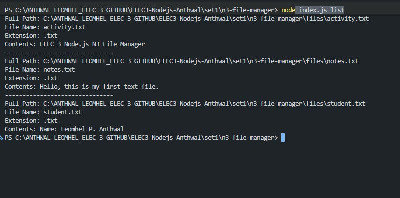

# ELEC 3 – Node.js Activities

**Name:** Leomhel P. Anthwal  
**Section:** IV-BSIT C  
**Course:** ELEC 3 – Node.js

## Set 1 Activities

### N1 – Project Setup and Package Management

This activity demonstrates how to initialize a Node.js project, install npm packages, configure package.json, and run a JavaScript program using npm start.

**Activity Folder:** [N1 – Project Setup](set1/n1-setup)

**How to Run:**

Open the terminal in the main repository folder and run:

```powershell
cd set1/n1-setup
npm install
npm start
```

### N1 Screenshot


## Upcoming Activities

- N2 – Modular Calculator
- N3 – File Manager with fs and path
- N4 – Basic HTTP Server
- N5 – REST-style API
- N6 – Middleware and API Testing


## N2 – Modular Calculator

A command-line calculator built with Node.js using
CommonJS modules. It supports addition, subtraction,
multiplication, division, and average.

### Run the program

```powershell
cd set1/n2-calculator
node index.js add 12 8
node index.js subtract 12 8
node index.js divide 12 8
node index.js multiply 12 8
```

### Activity Folder

[N2 – Modular Calculator](set1/n2-calculator)

### Screenshot




## N3 – File Manager with fs and path

**Activity:** N3 – File Manager  
**Student:** Leomhel P. Anthwal  
**Section:** IV-BSIT C

### Description

This Node.js program uses the built-in `fs` and `path` modules to manage text files. It supports creating, reading, updating, deleting, and listing files. It also handles missing-file errors without crashing.

### How to Run

Open a terminal in the `set1/n3-file-manager` folder.

```powershell
node index.js create sample.txt "Hello World"
node index.js read sample.txt
node index.js append sample.txt " Additional text"
node index.js list
node index.js delete sample.txt
```

### Project Folder

[N3 – File Manager](set1/n3-file-manager/)

### Screenshot – List Files



